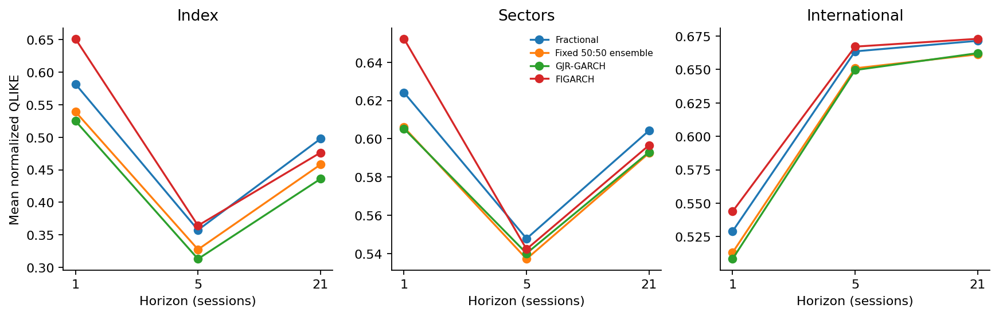

# ETF simulation with temporal memory

A conditional-variance model for the S&P 500, eleven sector ETFs and eight country ETFs, combining fractional memory with diffusion on a correlation graph. The repository contains the model, rolling forecast experiments, mathematical derivations and the manuscript.

The model uses positive fractional weights, a persistent variance state and a larger response to negative returns. The [manuscript](paper/main.pdf) derives its moment properties and forecasts; the [model specification](docs/refinement.md) connects the equations to the implementation. Download the [LaTeX package](paper/latex-source.zip) for the manuscript, figures, tables and bibliography.

Benchmarks include EWMA, GARCH, GJR-GARCH, FIGARCH and Network GARCH. The [country-ETF experiment](docs/external_validation.md) evaluates transfer beyond the US sector panel and a **fixed 50:50 fractional/GJR ensemble**. The [literature comparison](docs/related_work.md) sets out the model’s relation to existing network volatility specifications. A compact [arXiv source archive](paper/arxiv-source.zip) is also available.

The [Network GARCH experiment](docs/network_benchmark.md) compares weighted and binary graphs with a pooled control. The fractional model has lower average loss on country ETFs and higher loss on sectors than the weighted network; paired intervals include zero.

The [figure guide](docs/prediction_figures.md) explains the observed and forecast volatility paths, units, logarithmic scales and cross-asset dispersion bands.



*186 forecast origins per panel during 2023–2026. Lower loss is better; methods share targets within each panel. The US panels reuse development data. The international panel is a separate universe with rules fixed before download, still using retrospective adjusted prices.*

## Run the research workflow

Use **Python 3.12**. From the repository root, on macOS or Linux:

```bash
python3.12 -m venv .venv
source .venv/bin/activate
python -m pip install -r requirements.txt
python run_refinement.py --synthetic --output artifacts/refinement-synthetic
python -m unittest discover -s tests -v
```

The offline example uses 1,300 synthetic prices and saves forecasts, metrics, paired comparisons, fitting records and figures. Market results require the data described below.

To reproduce the market study with the documented local snapshot:

```bash
python run_refinement.py --data-dir artifacts/yahoo-through-2026-10-16 \
  --output artifacts/refinement-study --publish-assets
```

The [data guide](docs/data.md) documents the CSV format, downloader and source limitations. Market prices are not bundled. The [paper guide](paper/README.md) explains the recorded protocol, numerical outputs and LaTeX build. A fresh adjusted-price download may differ from the recorded snapshot.

## Recorded findings

Lower QLIKE means a better variance forecast on the common targets. Pooled scores are:

| Panel | Horizon | Refined fractional | Fixed 50:50 ensemble | GJR-GARCH | FIGARCH |
| --- | ---: | ---: | ---: | ---: | ---: |
| Index | 1 session | 0.5819 | 0.5393 | 0.5251 | 0.6514 |
| Index | 5 sessions | 0.3574 | 0.3274 | 0.3128 | 0.3642 |
| Index | 21 sessions | 0.4977 | 0.4580 | 0.4360 | 0.4764 |
| Sectors | 1 session | 0.6242 | 0.6060 | 0.6053 | 0.6523 |
| Sectors | 5 sessions | 0.5478 | 0.5371 | 0.5401 | 0.5422 |
| Sectors | 21 sessions | 0.6043 | 0.5925 | 0.5931 | 0.5966 |
| International | 1 session | 0.5290 | 0.5131 | 0.5083 | 0.5438 |
| International | 5 sessions | 0.6636 | 0.6509 | 0.6496 | 0.6671 |
| International | 21 sessions | 0.6715 | 0.6613 | 0.6623 | 0.6730 |

The fixed ensemble improves on the standalone fractional model and FIGARCH in all nine pooled comparisons. It beats GJR-GARCH in three, with small margins; all nine nominal 95% paired intervals against GJR include zero at both block lengths (five and ten origins). This establishes neither superiority nor equivalence to GJR. The international panel does not confirm a benefit from graph diffusion. The [complete external results](docs/external_validation.md) retain annual deterioration, per-asset exceptions and ablations. All 760 FIGARCH fits converged.

The earlier refinement itself improved the initial fractional specification in all six US comparisons and GARCH in four; GJR-GARCH remained stronger in all six. The [refinement results](docs/refinement.md) and [paired comparisons](paper/refinement_comparisons.csv) compare the persistent asymmetric model with its ablations.

The model has an explicit positive variance floor, a graph operator that preserves constants and contracts graph energy, and fixed-parameter stationarity and moment properties under stated assumptions. Its multi-step marginal variance forecasts are computed without Monte Carlo error. The empirical comparisons assess whether those restrictions help on the observed data.

The [forecast diagnostics](docs/forecast_diagnostics.md) report paired Diebold–Mariano tests, Mincer–Zarnowitz calibration regressions and per-asset win counts from the saved predictions. No loss comparison against GJR rejects at 5%. One-session country-panel calibration rejects for all three models at both HAC lag choices, including after multiplicity adjustment.

## Earlier simulations and price forecasts

The earlier return model and forecast extensions remain available:

```bash
python run_experiment.py --mode simulation --synthetic --output artifacts/simulation
python run_experiment.py --mode forecast --synthetic --output artifacts/fixed-blend
python run_adaptive.py --synthetic --output artifacts/adaptive-demo
python -m jupyter lab "Fraccional model S&P500 (final version).ipynb"
```

The [maintained notebook](Fraccional%20model%20S%26P500%20%28final%20version%29.ipynb) contains executed synthetic examples of the earlier simulator and adaptive price-forecast extension, followed by the new variance specification and its reproduction command. Change `DATA_DIR` to use local CSVs in the earlier examples.

The [adaptive specification](docs/adaptive_forecasting.md) explains the regularized forecast correction and error-based intervals. Its [execution record](docs/adaptive_results.md) reports improvements in interval scores and coverage; a simple drift forecast remains stronger on pooled point error. The [core forecast specification](docs/forecasting.md), [simulation methodology](docs/methodology.md) and [earlier results](docs/results.md) document the preceding workflows.

## Reproducibility and scope

Features, graph estimates, scaling, fitting and selection use only rows dated through each forecast origin in the recorded snapshot. The US historical periods were inspected during development. The international universe was fixed before its first download, but shares global shocks with the US assets and remains retrospective. Neither experiment is a prospective test. Daily squared-return targets are noisy volatility proxies. The [data-vintage discussion](docs/data.md#data-vintages-and-forecast-availability) explains which price revisions can change returns and what a prospective record would need to preserve.

The **79 passing tests** cover numerical recursions, conditional moments, graph properties, estimation gradients, forecast alignment and independence from future prices. They also check FIGARCH library agreement, ensemble scoring, HAC inference, calibration regressions, multiplicity adjustment, diffusion risk and forward-collection integrity. See the [verification guide](docs/verification.md) for the document and reproduction checks.

The standalone implementation is [refined_fractional.py](refined_fractional.py), with its experiment in [run_refinement.py](run_refinement.py). [external_validation.py](external_validation.py) and [run_external.py](run_external.py) add the frozen-universe comparison. The first variance specification remains in [fractional_diffusion.py](fractional_diffusion.py), reproduced by [run_paper.py](run_paper.py). The earlier return core is [temporal_memory.py](temporal_memory.py); [forecasting.py](forecasting.py) and [adaptive_forecasting.py](adaptive_forecasting.py) contain its separate forecast layers. The [original-model notes](docs/legacy_model_notes.md) explain why the original fractional-PDE derivation did not justify that return recurrence. The variance specifications have separate assumptions and proofs.

**Enia Ardid and Pablo Casado de Amezúa.** Citation metadata and distribution details are in [CITATION.cff](CITATION.cff) and the [publication notes](docs/publication.md).

## Citation and reuse

Please cite this project using [CITATION.cff](CITATION.cff) and identify the Git commit used. The manuscript has not been submitted to arXiv. No reuse license has been selected; see the [publication notes](docs/publication.md).

## Forward evaluation and diffusion risk

A [fixed-graph risk calculation](docs/diffusion_risk.md) separates noise reduction from the bias of smoothing genuinely different asset signals. Its reproducible positive-signal simulation includes both beneficial and harmful diffusion. These are mechanism results, not new market forecast scores.

The [frozen forward protocol](docs/prospective_evaluation.md) schedules new observations from October 27, 2026, with range-based volatility measurements, matched diffusion comparisons and a one-session target embargo. Model rules and code hashes are fixed before the future targets. No prospective accuracy result is available at launch.
