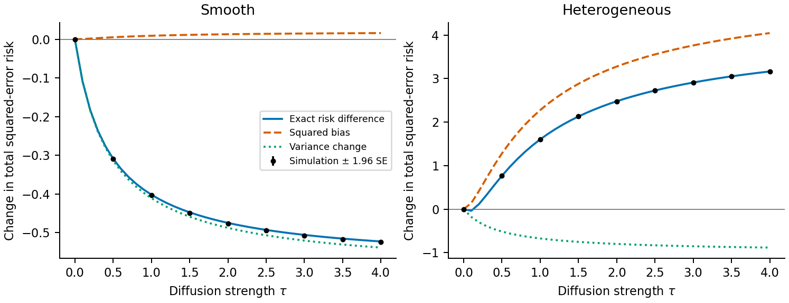

# When graph diffusion helps

Graph smoothing trades reduced measurement noise for bias when neighboring assets have genuinely different signals. This calculation makes that tradeoff explicit without assuming the fitted financial model necessarily gains forecasting accuracy.

Let $x=m+\varepsilon$ be a noisy signal. Conditional on a fixed graph and signal, assume $\mathbb E[\varepsilon]=0$ and $\operatorname{Cov}(\varepsilon)=\Sigma$. For a symmetric graph Laplacian $L$ and $\tau\geq0$, set

$$
A_\tau=(I+\tau L)^{-1}.
$$

The exact squared-error risk is

$$
R_\tau=\mathbb E\|A_\tau x-m\|_2^2
=\|(A_\tau-I)m\|_2^2+\operatorname{tr}(A_\tau\Sigma A_\tau).
$$

Relative to the unsmoothed signal,

$$
R_\tau-R_0=
\underbrace{\|(A_\tau-I)m\|_2^2}_{\text{squared bias}}
-\underbrace{\operatorname{tr}((I-A_\tau^2)\Sigma)}_{\text{noise reduction}}.
$$

The second term is nonnegative. **Diffusion helps precisely when noise reduction exceeds squared bias.** This is the standard linear-smoothing risk decomposition applied to the model's resolvent, not a new general result about all volatility estimators.

For orthonormal graph eigenvectors $v_k$, let $\lambda_k$ be their eigenvalues, $\theta_k=v_k^\top m$, $\nu_k=v_k^\top\Sigma v_k$ and $a_k=(1+\tau\lambda_k)^{-1}$. Then

$$
R_\tau-R_0=\sum_k\{(1-a_k)^2\theta_k^2-(1-a_k^2)\nu_k\}.
$$

Graph and noise covariance need not commute. For $\tau\lambda_k>0$, an individual mode benefits if

$$
\theta_k^2<\left(1+\frac{2}{\tau\lambda_k}\right)\nu_k.
$$

The aggregate inequality is necessary and sufficient; every mode need not improve. Constant modes on each connected component are unchanged. At zero strength, $R'_0=-2\operatorname{tr}(L\Sigma)$, so some sufficiently small positive strength improves risk if this trace is positive. Large strengths can introduce large bias.

## Scope for the forecasting model

For fixed $c,b,h,a$, smoothing the noisy forcing in $c\mathbf1+bh+aA_\tau x$ changes estimation risk by $a^2(R_\tau-R_0)$. This is a one-step conditional calculation, not a comparison of entire refitted recursions. Estimating the graph from the same noisy observations can invalidate the zero-mean conditional noise assumption. Correlation between measurement noise and future target noise introduces an additional covariance term. Finite measurement-noise covariance is an additional assumption; the core return second-moment result does not imply finite fourth moments. The calculation does not establish a QLIKE gain, a causal network effect, or universal superiority over GARCH.

The [forward protocol](prospective_evaluation.md) therefore compares fixed graph strengths while holding temporal parameters, asymmetry, mean and scale constant. It also retains the normally selected model, including its option to choose zero diffusion.

## Reproducible mechanism experiment

```bash
MPLCONFIGDIR=artifacts/matplotlib-cache python run_diffusion_risk.py --output artifacts/diffusion-risk
```

Eight assets lie on a cycle with edge weight $1/2$. Signals are $m_j=1+q(-1)^j$, and positive measurements are $x_j=m_j\chi^2_{24}/24$. The two prespecified illustrative amplitudes are $q=0.05$ and $q=0.8$. The script uses 40,000 draws, seed 20261026, and common random numbers across strengths. It verifies every simulated risk difference against its analytic value within six Monte Carlo standard errors.

| Signal | Risk without diffusion | Risk with $\tau=1$ | Difference |
|---|---:|---:|---:|
| Similar neighboring signals | 0.668333 | 0.266239 | −0.402094 |
| Heterogeneous neighboring signals | 1.093333 | 2.696557 | +1.603224 |

These are synthetic estimation risks, not market forecasting results. Full precision, simulation errors and hashes are retained in [the CSV](../paper/diffusion_risk.csv) and [manifest](../paper/diffusion_risk_manifest.json).


