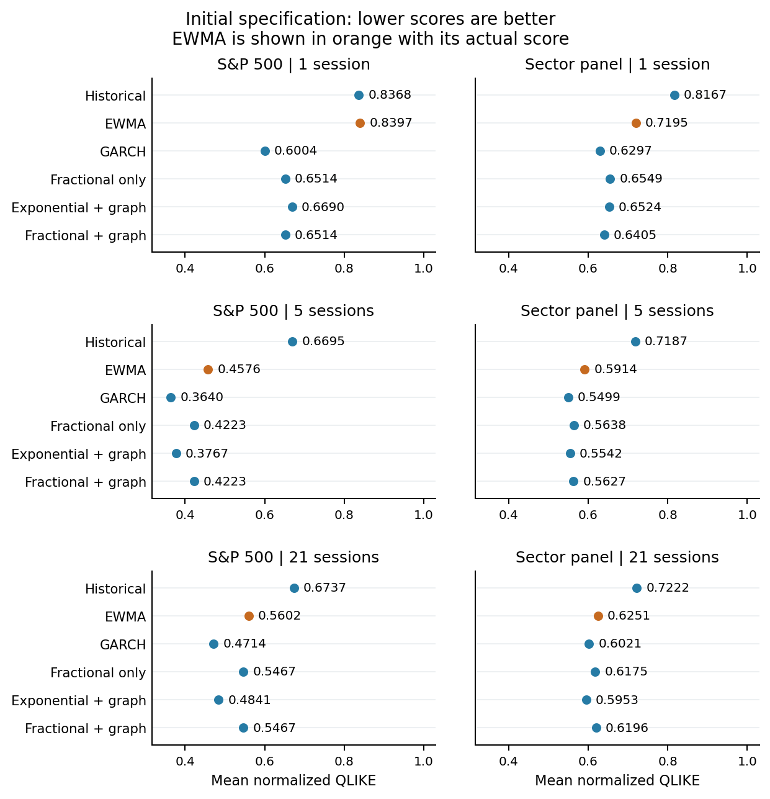
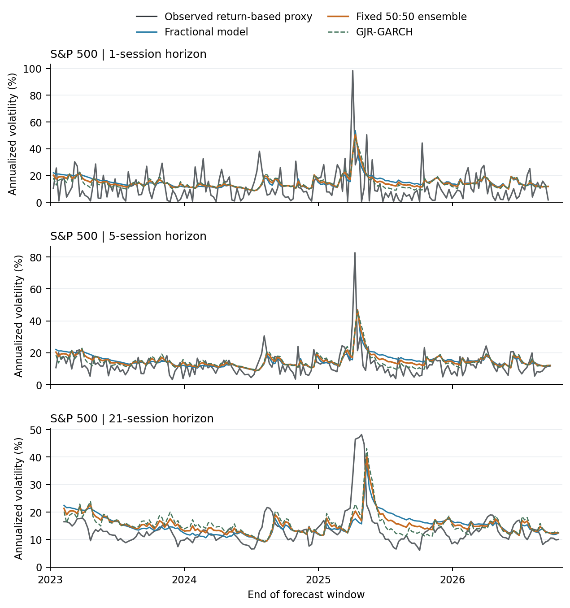
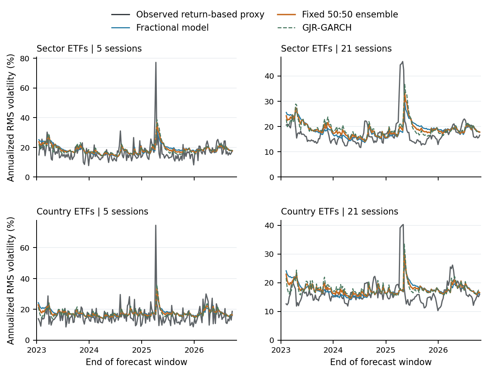

# Observed evolution versus model forecasts

The paper now includes the full recorded time paths, alongside the aggregate loss tables. These plots use saved forecasts: they do not fit models again, alter parameters or change scores.

## Reading the revised Figure 2

The previous version plotted `model QLIKE − EWMA QLIKE`. EWMA therefore had a zero-length bar, since it was subtracted from itself. Negative differences meant lower loss than EWMA; positive differences meant higher loss. Those signs were meaningful, but the chart made the reference look missing.

The revised figure displays **actual mean normalized QLIKE**, with one dot and a four-decimal label for every model, including EWMA in orange. Its six panels cover the index and sector panel at horizons of 1, 5 and 21 observations, on a common horizontal scale. Lower scores are better. Values match the initial-study table exactly; no absolute values, sign reversals or score transformations have been introduced.



## What the prediction curves show

The target in the current paper is the magnitude of future fluctuations, measured through a centered squared-return proxy. It is not the future direction of the price. Both variance forecasts and realized targets are shown in annualized volatility units:

$$
\widehat\sigma^{\mathrm{ann}}_{o,h,j}=100\sqrt{\frac{252}{h}\widehat V_{o,h,j}},
\qquad
\sigma^{\mathrm{proxy}}_{o,h,j}=100\sqrt{\frac{252}{h}Y_{o,h,j}}.
$$

The black curve is the subsequently observed return-based proxy. Blue is the persistent asymmetric fractional model, orange the fixed 50:50 ensemble, and dashed green GJR-GARCH. The square root of a variance forecast is displayed for readability; it is not generally the conditional expectation of volatility. The observed proxy is noisy, especially at one session, and is not latent volatility measured directly.

For the new plots, the date is **the end of the forecast window**. The prediction was issued 1, 5 or 21 observed trading sessions earlier, using only data available then. Lines connect forecasts issued every five observations. The 21-session windows overlap. The initial-study Figure 3 retains its explicitly labeled forecast-origin axis; it belongs to the earlier specification.



The multi-asset summaries average all marginal variances before taking the square root. They show root-mean-square marginal volatility, not portfolio volatility: they omit cross-asset covariance. They are also different from an arithmetic average of asset volatilities.



The appendix includes **all eleven sector ETFs and all eight country ETFs** at 21 sessions, without selecting assets or subperiods according to how closely the model tracks observations. Individual axes start at zero and have their own upper limits. Peaks are retained without clipping; no extra temporal smoothing is applied. The graphs complement the reported losses rather than replacing them with visual judgments.

## Regenerate the figures

Run from the repository root **after** the numerical study exporters, which preserve their original figure generators:

```bash
MPLBACKEND=Agg python render_prediction_figures.py \
  --study artifacts/external-study-complete
```

Then compile the paper and regenerate both archives:

```bash
cd paper
tectonic --reruns 3 main.tex
cd ..
python package_paper.py
```

The [renderer](../render_prediction_figures.py) verifies the saved score aggregates and each method's target/date alignment. The [figure manifest](../paper/prediction_figures_manifest.json) records the source hash, input hashes, transformations, complete asset lists and output hashes. The frozen numerical-study source files and protocols remain unchanged.
